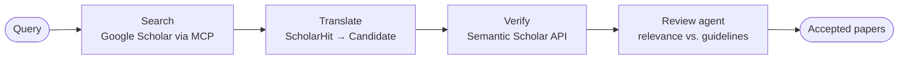

# paper-agent

[](LICENSE)

**A Go pipeline that finds academic papers and checks that they exist before anyone cites them.**

LLM research assistants are good at suggesting papers and bad at making sure those papers are real. `paper-agent` splits the job into separate stages: something proposes candidates, a deterministic step checks each one against a real bibliographic index, and only after that does a reviewer agent judge whether the paper fits the user's request. Each stage reads and writes a small JSON contract, so you can test, replace, or inspect any stage on its own.

> **Status: work in progress.** The search and candidate stages work end to end. The verification stage is being built right now. See the [roadmap](#roadmap).

---

## How it works



| Stage | What it does | State |
|---|---|---|
| **Search** | Starts a Google Scholar MCP server over stdio and calls its keyword-search tool | ✅ working |
| **Translate** | Turns raw hits into `Candidate`s (cleans titles, splits out authors and year) and saves them as JSON | ✅ working |
| **Verify** | Matches each candidate against Semantic Scholar and outputs a `Result` with canonical metadata, or `not_found` | 🚧 raw API call only |
| **Review** | An LLM agent accepts or rejects verified papers against the user's guidelines | ⏳ planned |
| **Finder agent** | An agent that writes search queries itself instead of taking a single fixed query | ⏳ planned |

### Design principles

- **Verify before judging.** Checking that a paper exists costs little and gives the same answer every time, so it runs before any LLM call. The reviewer never sees a paper that hasn't been matched to a real record.
- **Contract-first.** Stages talk only through the types in `internal/contract`. Example payloads in `schema/` are decoded with `DisallowUnknownFields` in tests, so if the docs and the code disagree, a test fails.
- **Tools behind MCP.** Search sources are reached through the [Model Context Protocol Go SDK](https://github.com/modelcontextprotocol/go-sdk). You can add or swap a source by changing config instead of code.

---

## Data contract

**`Candidate`**: a paper the search stage *claims* exists.

```json
{
  "result_id": "q01:r03",
  "title": "Attention is all you need",
  "authors_raw": "A Vaswani, N Shazeer, N Parmar… - Advances in neural …, 2017",
  "year": 2017,
  "link": "https://arxiv.org/abs/1706.03762",
  "doi": null,
  "arxiv_id": null
}
```

**`Result`**: what the verifier decided about that candidate. `status` is `verified` (with a `canonical` record) or `not_found` (with a `reason`).

```json
{
  "result_id": "q01:r07",
  "status": "not_found",
  "reason": "best match similarity 0.61 below threshold 0.90",
  "canonical": null
}
```

Full examples are in [`schema/`](schema/).

---

## Getting started

### Prerequisites

- Go **1.26+**
- A Google Scholar MCP server that exposes the `search_google_scholar_key_words` tool. <!-- TODO: link the server you use -->

### Configure the MCP server

Create `mcp_servers.json` in the repo root. It is gitignored because it holds local paths.

```json
{
  "mcpServers": {
    "google-scholar": {
      "command": "<launcher, e.g. uv or python>",
      "args": ["<args to start the server>"],
      "env": {}
    }
  }
}
```

> The config is decoded strictly. For now `env` must be an empty object, and any other key will be rejected.

### Run

```bash
mkdir -p results_tmp
go run ./cmd/paperbot scholar -q "adversarial robustness LLM geometry" -limit 5
```

This prints the raw Scholar hits and the translated candidates, and writes them to `results_tmp/candidates.json`.

| Subcommand | Flags | Description |
|---|---|---|
| `scholar` | `-q` (required), `-limit` (default 5), `-fixture` | Search → translate → save candidates |
| `api` | — | Dev stub: a test query against the Semantic Scholar search endpoint |

### Test

```bash
go test ./internal/contract/...
```

Tests under `internal/sources/scholar` need a working `mcp_servers.json` and network access, because they start the real MCP server.

---

## Project layout

```
cmd/paperbot/                 CLI entry point and subcommands
internal/contract/            Candidate / Result types, translation, JSON output
internal/sources/scholar/     Google Scholar MCP client and config loading
internal/checker/semanticScholar/   Semantic Scholar verification (WIP)
schema/                       Example payloads, also used as test fixtures
```

---

## Roadmap

- [x] Google Scholar search through MCP
- [x] `Candidate` contract and JSON output
- [ ] Semantic Scholar verification: title matching with a similarity threshold, DOI/arXiv ID lookups, `Result` output
- [ ] Offline fixtures for the `scholar` stage (the `-fixture` flag)
- [ ] Reviewer agent: relevance check against user guidelines
- [ ] Finder agent that plans its own queries
- [ ] Orchestrator with a dashboard showing each stage's inputs, outputs and decisions

---

## License

Released under the [MIT License](LICENSE).
